---

## 👋 About me

I'm an AI/ML engineer and developer from Vadodara. Over the past two years I've built data pipelines, predictive models, Android apps and websites. I joined SK Infosoft as an intern and was promoted to Associate Developer within a year, and I hold an MCA in Machine Learning & AI.

I like turning messy, manual processes into reliable, repeatable ones, and I care about models people can actually understand and trust.

## 🔭 What I work on

| | |
|---|---|
| 🤖 **Machine learning** | Predictive models, computer vision, explainable AI with SHAP |
| 🔄 **Data engineering** | ETL pipelines, automated reporting, Tableau dashboards |
| 📱 **Applications** | Python backends, REST APIs, on-device Android apps |
| 🎨 **Web and brand** | Websites and brand materials for small-business clients |

## 🛠️ Tech stack

## 🚀 Featured projects

| Project | What it does | Built with |
|---|---|---|
| **EV Battery Defect Detection** | Six-class classifier on 3,501 batteries, with SHAP explaining every prediction | Python, Scikit-learn, SHAP, PCA |
| **Sleep Disorder Risk Classifier** | Benchmarked four models on 100,000 records; the best hit **94.92%** accuracy on held-out data | Python, Scikit-learn, Pandas |
| **AI-Powered Audio Vision Assistant** | Accessibility-focused Android app giving audio feedback for real-time object recognition | Kotlin, TensorFlow Lite, Firebase, Cloud Vision API |
| **Real-Time Object Detection System** | On-device detection and classification on Android | Kotlin, TensorFlow Lite, SQLite |
| **Pedestrian Detection** | Faster R-CNN model trained on the PennFudanPed dataset | Python, deep learning |
| **Interactive web projects** | Hindi-themed music player, Friendship Day word-search experience, binary calculator with saved history | HTML, CSS, JavaScript |

## 📊 GitHub at a glance

## ⚡ How I work

- 🛠️ **I build end to end.** I like taking an idea from the first brief to something people can use, whether that's a model, an app or a website.
- 🚀 **I learn fast and own the result.** I went from intern to Associate Developer in a year by picking up new tools and delivering.
- 🔍 **I want to know why.** I'd rather ship a model I can explain than one that just scores well.
- 🎯 **I keep things simple and direct.** Small problems, clean code, clear communication.
- 🌍 **I'm comfortable working remotely.** I manage my own time and work well with both technical and non-technical people.

## 🌱 Currently learning

- 🧠 Deep Learning & Neural Networks
- 💬 Social Media & Text Analytics
- 🏢 SAP solution design (Coursera SAP Technology Consultant certificate)
- ☁️ Cloud computing and full-stack development

## 🤝 Open to

- Remote roles in ML, data, Python backend or automation
- Open source contributions
- AI and machine learning projects
- Travel management systems, a side project around booking and tracking

## 🎮 Outside of code

FPS games and trying out new cuisines in the kitchen.

---

**Let's build something together.** Reach out on [LinkedIn](https://www.linkedin.com/in/haritmengar) or [email me](mailto:haritmengar12@outlook.com).

